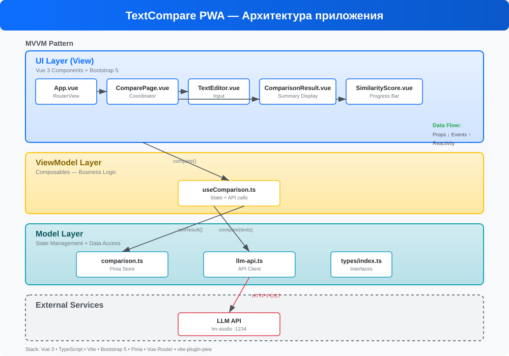

# TextCompare PWA

Прогрессивное веб-приложение для сравнения двух текстов с использованием LLM API.

## Архитектура



Приложение следует паттерну **MVVM** с тремя слоями:
- **View** — Vue-компоненты с Bootstrap 5
- **ViewModel** — Composables с бизнес-логикой
- **Model** — Pinia-сторы и API-клиент

## Стек технологий

- Vue 3 (Composition API)
- TypeScript
- Bootstrap 5
- Vite
- Pinia
- Vue Router
- vite-plugin-pwa

## Установка

```bash
pnpm install
```

## Запуск dev-сервера

```bash
pnpm dev
```

## Сборка для продакшена

```bash
pnpm build
```

## Предпросмотр сборки

```bash
pnpm preview
```

## Конфигурация

Создайте файл `.env` с переменными окружения:

```env
VITE_LLM_API_URL=https://api.example.com
VITE_LLM_API_KEY=your-api-key-here
```
